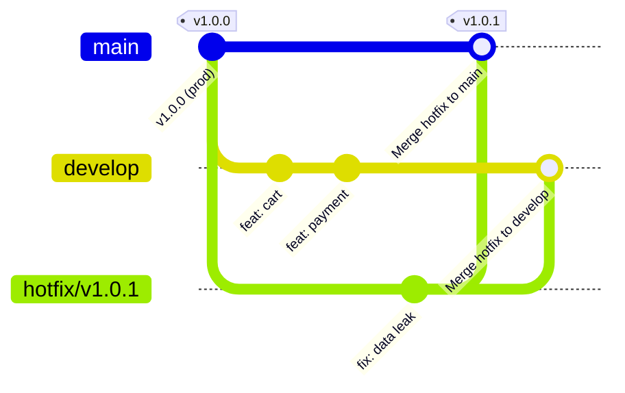

# Báo cáo Bài 4: Mô phỏng quy trình Hotfix & Gitflow thực tế

## 1. Thông tin bài tập
- **Bài thực hành**: Bài 4 - Mô phỏng quy trình Hotfix & Gitflow thực tế
- **Đường dẫn nộp bài**: `homework/session_05/ex4/`
- **Môn học / Khóa học**: Quản lý phiên bản với Git (IT209 - Session 05)

---

## 2. Mục tiêu
- Áp dụng chuẩn mô hình phân nhánh **Gitflow Workflow** trong quản trị mã nguồn và phát hành phần mềm chuyên nghiệp.
- Thành thạo quy trình xử lý lỗi khẩn cấp (*Hotfix*): tách nhánh trực tiếp từ `main`, sửa lỗi, kiểm thử và tích hợp trở lại môi trường production.
- Hiểu và thực thi việc **đồng bộ hóa ngược (back-merge)** bản vá nóng vào nhánh `develop`, ngăn chặn triệt để nguy cơ trôi lỗi (*regression bugs*) ở các phiên bản tương lai.
- Sử dụng Git Tag để gắn nhãn các mốc phát hành chính thức theo chuẩn Semantic Versioning (SemVer).

---

## 3. Tổng quan về mô hình Gitflow và vai trò của nhánh Hotfix

Trong quy trình Gitflow tiêu chuẩn:
- **`main` (hoặc `master`)**: Chứa mã nguồn ổn định nhất đang chạy trên môi trường Production. Mỗi commit trên `main` đại diện cho một bản phát hành chính thức và thường được gắn Tag.
- **`develop`**: Nhánh tích hợp chính cho các tính năng mới đang trong quá trình phát triển (Nightly / Staging).
- **`feature/*`**: Các nhánh tính năng con được tách ra từ `develop` và gộp về `develop`.
- **`hotfix/*`**: Nhánh sửa lỗi khẩn cấp **duy nhất** được tách ra trực tiếp từ `main`. Dùng khi phát hiện lỗi nghiêm trọng trên Production cần vá ngay lập tức mà không thể đợi các tính năng dở dang trên `develop` hoàn thành.



---

## 4. Tình huống giả lập & Các bước thực hiện

### 4.1. Bối cảnh
- Hệ thống đang chạy trên nhánh `main` với phiên bản `v1.0.0` (tệp `app.py`).
- Nhánh `develop` đang phát triển dở dang 2 tính năng mới: giỏ hàng (`cart.py`) và thanh toán (`payment.py`), chưa sẵn sàng để deploy.
- **Sự cố nghiêm trọng:** Phát hiện `app.py` làm lộ `secret_token` của người dùng. Cần vá gấp và release phiên bản `v1.0.1` ngay lập tức!

---

### 4.2. Các bước triển khai chi tiết

#### Bước 1: Chuẩn bị môi trường ban đầu
```bash
git init -b main
git config user.name "Student"
git config user.email "student@example.com"

# 1. Khởi tạo phiên bản v1.0.0 trên main
cat << 'EOF' > app.py
def get_user_profile():
    return {"id": 1, "name": "Alice", "secret_token": "xyz123"}
EOF

git add app.py
git commit -m "release: v1.0.0 phien ban on dinh"
git tag -a v1.0.0 -m "Release version 1.0.0"

# 2. Tạo nhánh develop và phát triển tính năng mới
git checkout -b develop

echo "# Tinh nang gio hang dang phat trien" > cart.py
git add cart.py
git commit -m "feat: dang phat trien tinh nang gio hang"

echo "# API thanh toan dang lam do" > payment.py
git add payment.py
git commit -m "feat: them api thanh toan (dang do)"
```

---

#### Bước 2: Tách nhánh sửa lỗi khẩn cấp `hotfix/v1.0.1` từ `main`
Tuyệt đối không tách hotfix từ `develop` vì `develop` đang chứa code chưa hoàn thiện.
```bash
git checkout main
git checkout -b hotfix/v1.0.1
```

Tiến hành sửa lỗi bảo mật trong `app.py`:
```python
def get_user_profile():
    return {"id": 1, "name": "Alice"} # Fixed: Da loai bo secret_token
```

Commit bản vá:
```bash
git commit -am "fix: va loi bao mat lo du lieu nguoi dung"
```

---

#### Bước 3: Gộp Hotfix vào `main` và đánh tag phát hành `v1.0.1`
Chuyển về `main`, gộp nhánh hotfix với tùy chọn `--no-ff` (tạo merge commit rõ ràng để lưu vết lịch sử trong Gitflow):
```bash
git checkout main
git merge --no-ff hotfix/v1.0.1 -m "Merge branch 'hotfix/v1.0.1' into main"
```

Tạo tag phiên bản phát hành chính thức `v1.0.1`:
```bash
git tag -a v1.0.1 -m "Release Hotfix 1.0.1"
```

---

#### Bước 4: Đồng bộ hóa ngược (Back-merge) Hotfix vào `develop`
Đây là bước **bắt buộc** trong Gitflow để đảm bảo các lập trình viên trên nhánh `develop` nhận được bản vá, tránh tình trạng khi `develop` release `v1.1.0` trong tương lai sẽ mang lại lỗi cũ (*Regression Bug*).
```bash
git checkout develop
git merge --no-ff hotfix/v1.0.1 -m "Merge branch 'hotfix/v1.0.1' into develop"
```

---

#### Bước 5: Dọn dẹp nhánh Hotfix
Sau khi đã tích hợp vào cả `main` và `develop`, nhánh hotfix đã hoàn thành sứ mệnh và có thể xóa an toàn:
```bash
git branch -d hotfix/v1.0.1
```

---

## 5. Kiểm tra & Nghiệm thu kết quả

### 5.1. Kiểm tra danh sách nhánh
```bash
git branch -a
```
**Kết quả hiển thị:**
```text
* develop
  main
```
✅ Nhánh `hotfix/v1.0.1` đã được xóa sạch sẽ, chỉ còn 2 nhánh dài hạn `main` và `develop`.

---

### 5.2. Kiểm tra danh sách Tag
```bash
git tag
```
**Kết quả hiển thị:**
```text
v1.0.0
v1.0.1
```
✅ Tag `v1.0.1` đã được tạo thành công cho bản vá nóng.

---

### 5.3. Kiểm tra sơ đồ lịch sử commit (`git log --graph --oneline --all`)
```bash
git log --graph --oneline --all
```

**Kết quả sơ đồ commit thực tế:**
```text
*   ba391e1 (HEAD -> develop) Merge branch 'hotfix/v1.0.1' into develop
|\  
* | 965aed8 feat: them api thanh toan (dang do)
* | 81355ab feat: dang phat trien tinh nang gio hang
| | * 023f4a8 (tag: v1.0.1, main) Merge branch 'hotfix/v1.0.1' into main
| |/| 
|/|/  
| * 6a7fa85 fix: va loi bao mat lo du lieu nguoi dung
|/  
* 0b72680 (tag: v1.0.0) release: v1.0.0 phien ban on dinh
```

---

### 5.4. Sơ đồ mô phỏng ASCII đồ thị phân nhánh Gitflow

```text
    (main) v1.0.0 ──────────────────────────────────────────[023f4a8] v1.0.1 (Production)
           [0b72680]                                             ▲
               │ \                                              /
               │  \─── hotfix/v1.0.1: [6a7fa85] fix leak ──────/ \
               │                                                  \
               ▼                                                   ▼
           (develop) ─── [81355ab] cart ─── [965aed8] payment ─► [ba391e1] (Sync Hotfix)
```

---

### 5.5. Kiểm tra tính toàn vẹn của mã nguồn trên từng nhánh

1. **Trên nhánh `main`:**
   ```bash
   git checkout main
   ls
   ```
   **Kết quả:** Chỉ có `app.py` (chứa bản vá bảo mật). Không bị lẫn các file chưa hoàn thiện (`cart.py`, `payment.py`). Môi trường production an toàn và sạch sẽ tuyệt đối.

2. **Trên nhánh `develop`:**
   ```bash
   git checkout develop
   ls
   ```
   **Kết quả:** Có đầy đủ cả `app.py` (đã được vá lỗi), `cart.py` và `payment.py`. Tiến trình phát triển các tính năng tương lai tiếp tục diễn ra bình thường mà không bị gián đoạn.

---

## 6. Tổng kết & Bài học thực tế

1. **Tính độc lập của Hotfix:**
   - Nhánh `hotfix` cho phép đội ngũ phản ứng lập tức với sự cố production mà không cần phải chờ hay loại bỏ (revert) các tính năng chưa hoàn thiện đang nằm trên `develop`.
2. **Nguyên tắc "Đồng bộ hai chiều":**
   - Bất kỳ thay đổi nào đưa lên `main` thông qua `hotfix` **bắt buộc phải được merge vào `develop`**. Bỏ quên bước này là nguyên nhân hàng đầu gây tái phát lỗi cũ (*regression bug*) khi phát hành phiên bản tiếp theo.
3. **Ý nghĩa của cờ `--no-ff` (No Fast-Forward):**
   - Trong Gitflow, luôn sử dụng `git merge --no-ff` khi gộp hotfix hoặc release. Điều này giúp bảo toàn ngữ cảnh rằng các commit sửa lỗi từng thuộc về một nhánh hotfix cụ thể, thuận tiện cho việc tra cứu nhật ký và audit hệ thống sau này.
